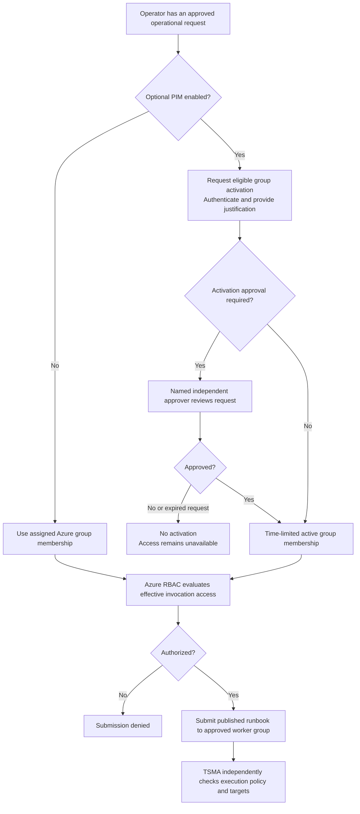
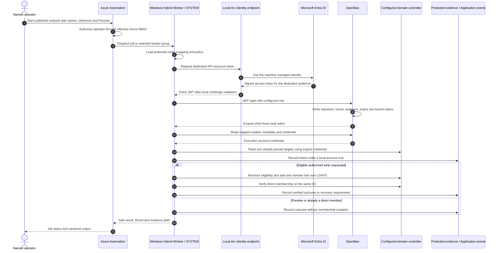
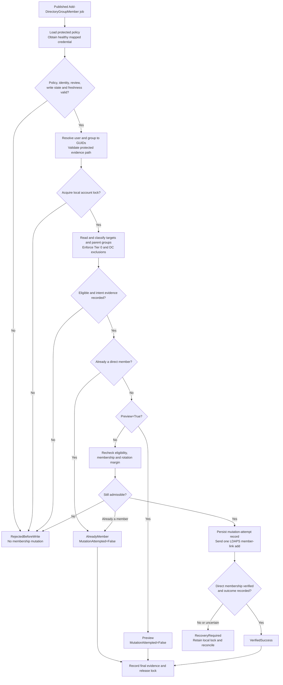
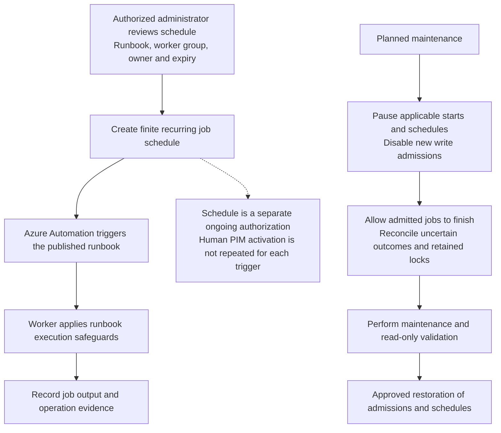

# Approval and execution workflows

These diagrams separate human access approval, workload authentication, directory safeguards and schedule authorization. They describe the documented TSMA Azure Automation/OpenBao deployment; each environment supplies its own policy settings and accountable people.

## 1. Human approval and runbook submission

A business ticket/change approval and PIM activation approval are separate decisions. TSMA records the supplied ChangeReference; it does not query a ticket system or verify CAB approval. PIM is optional and controls human group activation before Azure invocation.

Approval is shown as configurable because PIM policy determines whether an approver is required. For the recommended production settings and eligibility/ownership controls, see [optional Entra PIM](advanced/ENTRA-PIM.md). Baseline group/RBAC configuration is documented in [operator access](setup/OPERATOR-ACCESS.md). Account-scoped invocation rights apply to the account's runbooks; PIM does not narrow that scope.

Activation expiry/deactivation restricts new requests after propagation; it does not automatically cancel queued/running jobs or invalidate established AD sessions. Independent grant paths and group-owner privileges must also be reviewed.

## 2. Workload identity and credential flow

The human operator, worker SYSTEM process, Arc machine identity and AD execution account are distinct. The worker receives the password in memory; the operator receives only safe job output. Tokens, challenge-file contents and passwords must never be written to job output or evidence.

The sequence shows the successful authentication path. Invalid identity bindings, unhealthy/stale credentials, unsafe configuration, unavailable evidence or ineligible targets fail closed. The JWT role/policy and credential-provider implementation enforce access independently of the human's PIM activation. See [architecture](ARCHITECTURE.md), [Entra/OpenBao trust](setup/ENTRA-OPENBAO.md) and [credential contract](CONTRACTS.md).

## 3. Directory operation decisions and recovery

Preview defaults True. The write-state gate applies to write requests; preview can remain available during maintenance while scope review and other policy checks are valid. Protected objects, privileged ancestry, unknown classification, disabled users and unsupported groups are rejected. Early rejection can precede creation of a RunId/evidence record.

The diagram summarizes the normal success paths. A failed final evidence/event write can itself require recovery; an intended success outcome is not accepted when its recording fails. Pre-mutation rejection releases any acquired lock when cleanup succeeds. A marked/uncertain mutation keeps the lock and requires actual-state reconciliation; it does not trigger automatic membership removal or blind retry.

The local lock serializes this operation on one worker. It does not coordinate other consumers or OpenBao's independent password-rotation timer. See [group membership procedure](ADD-DIRECTORY-GROUP-MEMBER.md) and [recovery procedure](OPERATIONS.md).

## 4. Recurring jobs and maintenance authorization

A schedule must have its own reviewed operating authorization; do not treat one human PIM activation as approval for indefinite future automation. The bundled schedule helper creates a finite read-only service-health schedule, not privileged directory mutations or password rotation. Directory-write admission controls do not pause read-only health schedules automatically.

OpenBao performs scheduled AD password rotation independently; these diagrams do not imply a distributed maximum-age-plus-drain coordinator. Disabling new admissions allows already admitted work to finish. Urgent containment uses the separately governed incident-response process. See [installation and schedules](INSTALL.md) and [maintenance](OPERATIONS.md).
